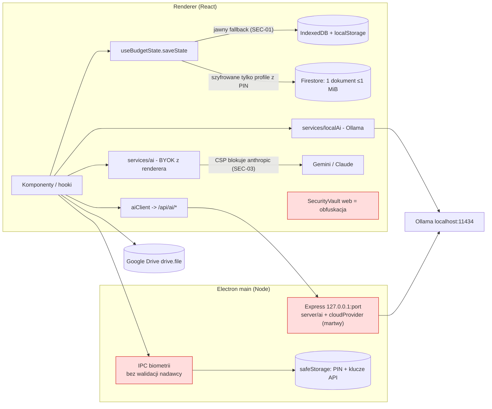
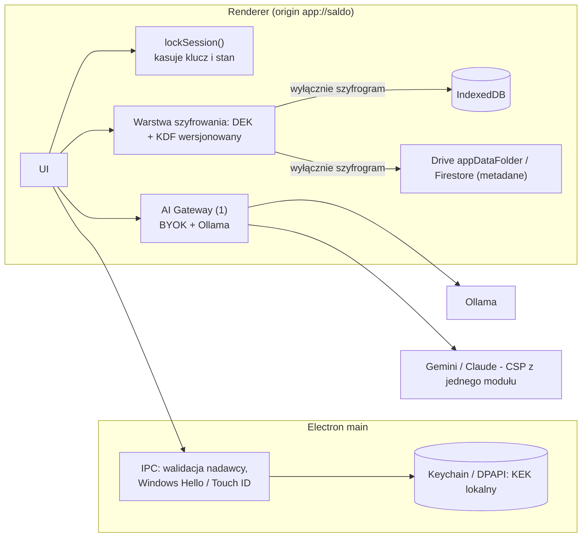

# Audyt aplikacji Saldo v1.6.6

**Data:** 2026-11-12 · **Commit bazowy:** `40ce623` (HEAD gałęzi `claude/inspiring-turing-y6vtni`) · **Zakres:** całe repozytorium (65 291 LOC kodu, 32 290 LOC testów) · **Pliki towarzyszące:** `BACKLOG.csv` (74 pozycje, średniki, UTF-8)

> **UWAGA PRAWNA.** Ten audyt nie zastępuje profesjonalnego audytu bezpieczeństwa przeprowadzonego przez certyfikowaną firmę. Przed szerszą dystrybucją zalecany jest zewnętrzny test penetracyjny. Części dotyczące RODO to analiza techniczna, nie opinia prawna.

**Legenda wiarygodności** (przy każdym ustaleniu):
**[T]** potwierdzone testem lub pomiarem uruchomionym w tej sesji · **[K]** potwierdzone lekturą kodu, nieuruchamiane · **[H]** hipoteza do sprawdzenia.

---

## 0. Metoda i ograniczenia (czytać przed resztą)

**Co faktycznie uruchomiono:** `tsc --noEmit` (czysto) · `vitest` (137 plików, 1306 testów, wszystkie zielone) · `vite build` · `npm audit` (pełny i `--omit=dev`) · 21 testów e2e Playwright (21/21 zielonych, po podmianie przeglądarki na preinstalowaną) · własny skrypt budujący graf importów na API kompilatora TypeScript · pomiar PBKDF2 · sondę CSP w Chromium na serwerze produkcyjnym · 5 zimnych startów z pomiarem FCP/LCP · wyliczenie kontrastu WCAG z tokenów CSS · jednorazowy test dowodowy dla SEC-01 (usunięty z repo, kod w Dodatku D).

**Czego NIE zrobiono — i dlaczego to ważne:**

| Luka | Konsekwencja dla wniosków |
|---|---|
| Nie uruchomiono prawdziwego Electrona (tylko serwer Express + Chromium) | Ustalenia o IPC, portach, Touch ID/DPAPI są z lektury kodu **[K]**, nie z działania. |
| Nie mierzono Lighthouse konkurencji, nie przeglądano ich kodu | Sekcja 5.3 to wiedza ogólna, **niezweryfikowana** w tej sesji. |
| Brak Ollamy i danych użytkowników | Dokładność AI: brak własnych pomiarów. Cytuję wyłącznie liczby z komentarza w kodzie (nieodtwarzalne, dane w `.gitignore`). |
| Nie uruchamiano emulatora Firestore | Reguły przeczytane, nie przetestowane. |
| Nie ma telemetrii użycia (słusznie, local-first) | Oceny użyteczności AI to osąd ekspercki, nie dane. |
| `npx madge` został zablokowany przez środowisko, nie obchodziłem tego | Graf zależności policzyłem własnym skryptem (Dodatek E) — wyniki równoważne dla statycznych importów. |
| Brak dostępu do zespołu | **Timeline'y w roadmapie to moje szacunki, nie wynik konsultacji.** Pozycji „konsultacja z dev team” z checklisty nie da się odhaczyć. |

---

## 1. Executive Summary

**Werdykt.** Saldo ma solidny fundament inżynieryjny (1306 zielonych testów, czysty `tsc`, jeden cykl importów w 204 modułach, brak sinków XSS, sensowny baseline Electrona, AI z człowiekiem w pętli). Jednocześnie **obecna deklaracja „bezpieczniejsza niż płatne rozwiązania” i „zero-knowledge” nie jest zasadna**: główna bariera (szyfrowanie profilu PIN-em) ma trzy zmierzone/udowodnione słabości, a część dokumentacji bezpieczeństwa opisuje mechanizmy, których w kodzie nie ma.

### Top 5 priorytetów

| # | Działanie | Dlaczego | ID | Nakład |
|---|---|---|---|---|
| 1 | **Przestać zapisywać profil z PIN jawnym tekstem po auto-locku** i traktować blokadę jako realne czyszczenie sesji | **[T]** test dowodowy: po usunięciu klucza zapis trafia jawnie do IndexedDB **i** `localStorage`. Grupa kontrolna z kluczem jest zaszyfrowana. | SEC-01, SEC-05 | M |
| 2 | **Naprawić model kluczy:** klucz szyfrujący nie może mieć entropii 4–8-cyfrowego PIN-u | **[T]** 20,9 ms/próbę/rdzeń → 4 cyfry ≈ 3,5 min, 6 cyfr ≈ 5,8 h na jednym rdzeniu (GPU o rzędy szybciej). Sól i szyfrogram są też w Firestore. | SEC-02, PRIV-01 | XL |
| 3 | **Dodać `api.anthropic.com` do CSP i testować e2e na buildzie produkcyjnym** | **[T]** w Chromium z produkcyjnym CSP połączenie jest blokowane; Gemini przechodzi. W dev CSP jest wyłączony, więc 21 zielonych e2e tego nie widzi. | SEC-03, TEST-01 | S |
| 4 | **Higiena łańcucha dostaw:** `.mcp.json` (pakiet nie istnieje w npm), Electron/zod/express, bramki w CI, plik LICENSE | **[T]** `npm view` → 404; `npm audit` → 44 (4 crit); brak LICENSE blokuje też darmowy podpis kodu (SignPath). | SEC-04, SEC-08, SEC-09, LEGAL-01 | S |
| 5 | **Szybkie wygrane:** dynamiczny import Firestore (−174 kB gzip na starcie), kontrast kolorów kwot, automatyczna kopia zapasowa | **[T]** start 424 kB gzip → ok. 254 kB; `text-success` 3,30:1 i `text-warning` 3,19:1 < 4,5:1; brak auto-backupu = główny scenariusz utraty danych. | PERF-01, A11Y-01, UX-01 | S/S/M |

**Co działa dobrze (i nie należy tego psuć):** czysty `tsc`; 1306 testów; walidacja zod wejścia i wyjścia na `/api/ai`; akcje AI tylko wypełniają formularz (granica przed prompt injection); plany liczone deterministycznie; zakres Google `drive.file` (najmniejsze uprawnienia); sesja Firebase `browserSession`; Electron z `sandbox`+`contextIsolation`+bez `nodeIntegration`; allowlista okien auth; szyfrowanie AES-GCM z losowym IV i kluczem `extractable:false`; FCP 892 ms przy 4× throttlingu CPU; brak `dangerouslySetInnerHTML`/`eval`.

**Liczby:** 74 pozycje backlogu: **P0: 4 · P1: 17 · P2: 30 · P3: 23**. Weryfikacja: 18 **[T]**, 45 **[K]**, 11 **[H]**. Uczciwie: ok. 20 pozycji jest istotnych, reszta to higiena — próg „minimum 50” z checklisty wymusił wpisanie także drobiazgów (oznaczone P3).

---

## 2. Założenia zadania, z którymi się nie zgadzam

1. **PCI DSS nie ma tu zastosowania.** Dotyczy danych kart płatniczych (PAN/CVV). Saldo ich nie przetwarza (grep: brak numerów kart). Wpisanie PCI DSS do checklisty to zgodność pozorna. Właściwy punkt odniesienia: **OWASP ASVS (L2)** + RODO. Sensowna jest tylko drobna pozycja: maskowanie ciągów 13–19 cyfr w opisach importu (PRIV-06).
2. **„Audit logging wszystkich operacji finansowych” jest tu źle dobrane.** W jednoosobowej aplikacji lokalnej posiadacz danych może edytować dziennik, więc nie ma on wartości dowodowej. Użyteczna jest historia zmian/cofanie (częściowo istnieje: `historyState`). Pełny audit log ma sens dopiero przy serwerze wieloużytkownikowym (PRIV-07, backlog).
3. **„TLS 1.3+” dla całości:** w Electronie UI idzie po `http://127.0.0.1` (loopback), więc TLS nie ma tu zastosowania, a nagłówki HSTS i `upgrade-insecure-requests` są bezprzedmiotowe (SEC-17). TLS dotyczy hostingu web (Firebase Hosting) i połączeń do Google/NBP/Anthropic — poza kontrolą projektu.
4. **„Bundle < 200 kB” jest metryką web/PWA, nie desktopu.** Electron ładuje z localhost; zmierzone FCP 892 ms przy 4× throttlingu CPU. Priorytet P1 tylko jeśli wersja web jest realnym kanałem dystrybucji.
5. **„Bezpieczniejsza niż płatne konkurencyjne rozwiązania”** jest niemierzalne bez definicji. Proponuję kryteria: pokrycie ASVS L2, zero znanych wykorzystywalnych podatności zależności, realne E2EE dla *każdej* kopii w chmurze, niezależny pentest z opublikowanym streszczeniem.
6. **„Minimum 50 problemów”** zachęca do zawyżania liczby. Zachowałem próg, ale sortuję według wagi — patrz uczciwa uwaga w §1.

---

## 3. Poziom 1 — Architektura i zależności

### 3.1 Mapa

| Warstwa | Zawartość | Rozmiar |
|---|---|---|
| UI | `src/components/**`, `src/app/**` (shell, router, ModalManager, onboarding) | 204 moduły produkcyjne |
| Stan i akcje | `hooks/useBudgetState`, `useAppActions`, `useProfileSecurity`, `useDriveSync`, `AppContext` | |
| Domena | `services/*` — kredyty (2892 LOC), budżet, podatki PL, prognozy, import (Alior, Zen, CSV, PDF), reguły | |
| Persystencja | IndexedDB + lustro `localStorage` (`localDb.ts`), Firestore (jeden dokument na użytkownika), Google Drive | |
| Serwer lokalny | Express 5 (`server.ts`, `src/server/**`) — statyki + `/api/ai/*` | 3442 LOC z Electronem |
| Desktop | `electron/main.cjs` (1062 LOC), `preload.cjs`, `statementWatcher.cjs` | |

Diagramy przed/po: Dodatek A.

### 3.2 Graf zależności **[T]** (własny skrypt, statyczne importy bez type-only)

* 204 moduły, 609 krawędzi, **1 cykl:** `DebtDetailsModal.tsx ↔ DebtPortfolioCard.tsx` (ARCH-04).
* Fan-in: `types.ts` 108, `utils.ts` 46, `utils/format.ts` 43, `useFocusTrap` 33. Fan-out największy: `debts/DebtsView.tsx` 23.
* **Brak** odwróconych zależności `services → components`/`hooks`.
* **4 naruszenia warstw (ARCH-05):** `server/*` importuje kod klienta — `SecurityVault`, `localParsers`, `financialSkills`, `aiActions`.

### 3.3 Red flags z listy zadania

| Red flag | Werdykt | Dowód |
|---|---|---|
| Circular dependencies | 1, drobny | j.w. |
| Tight coupling | Niski (graf bez odwróconych zależności); pokrycia testami nie mierzyłem — brak raportu coverage (TEST-03) | 137 plików testów, 1306 przypadków |
| **God objects** | **Tak** | `DebtDetailsModal` 2943 LOC, `debtCalculations` 2892, `pdfGenerator` 1578, `debts/DebtsView` 1560, `AnalysisView` 1382, `ImportTransactionsModal` 1263, `electron/main.cjs` 1062 (ARCH-03) |
| Duplikacja logiki | **Tak: trzy stosy AI** | `server/ai`+`routes/ai.ts`, `services/ai` (BYOK z renderera), `services/localAi.ts`+`aiClient.ts`. Serwerowy tryb `cloud` jest nieosiągalny (nic nie ustawia `cloudAiProvider`/`cloudAiApiKeyRef`; `SecurityVault` w Node nie ma kluczy) → ~300 LOC martwego kodu (AI-01) **[K]** |
| Brak API boundaries | Częściowo | `any`: 200 użyć w kodzie produkcyjnym; zod tylko na `/api/ai` (ARCH-06) |
| Event storms | Nie stwierdzono | brak magistrali zdarzeń |

### 3.4 Inne ustalenia architektoniczne

* **Origin zależny od portu (ARCH-01, P1) [H]:** `electron/main.cjs` zapisuje port (domyślnie 47819); gdy zajęty, wybiera losowy, a IndexedDB jest per-origin. Kod sam ostrzega logiem: *„dane lokalne mogą być niewidoczne w tej sesji”*. Użytkownik nie dostaje komunikatu. Docelowo: `protocol.handle('app')` ze stałym origin, bez serwera HTTP dla UI.
* **Synchronizacja = jeden dokument ≤ 1 MiB (ARCH-02):** twardy sufit; ostrzeżenie przy 900 kB.
* **Martwy kod:** `secureStorageStrategy.ts` (zero użyć), `debts/mockData.ts` (poza testami), serwerowy `cloudProvider.ts`.
* **Dwuznaczność:** `src/utils.ts` obok katalogu `src/utils/`; zduplikowany test `useAppActions.payment.test.ts`.
* **Pozostałości AI Studio:** `metadata.json`, `firebase-blueprint.json` (nieaktualny), `scripts/export-to-ai.cjs` (zrzuca kod źródłowy, *nie* dane użytkownika — sprawdziłem).

---

## 4. Poziom 2 — Bezpieczeństwo

### 4.1 Ustalenia krytyczne i wysokie

**SEC-01 (P0) [T] — jawny zapis po auto-locku.**
`useBudgetState.saveState` wywołuje `prepareStateForRemoteSave`; dla profilu z PIN bez klucza w `activeKeys` ta funkcja rzuca wyjątek (zgodnie z projektem). Kod łapie go, ustawia komunikat, ale **zapisuje `stampedState` — jawny — do IndexedDB i do `localStorage['saldo-local-fallback-v2']`**. Auto-lock (`AppContent.onLock`) kasuje klucz, lecz profile w stanie Reacta zostają odszyfrowane, więc każdy późniejszy zapis niesie jawne dane.
Test: ciąg `TAJNY-ZAKUP-12345` jest widoczny w obu magazynach po locku; z kluczem w pamięci — nie (kontrola). **Nie udowodniłem natomiast konkretnego wyzwalacza w UI** przy zablokowanym profilu (np. synchronizacja w tle, tray „dodaj wydatek”) — to do sprawdzenia w działającym Electronie.
*Uwaga o intencji:* komentarz w kodzie mówi, że zmiana „i tak musi trafić na urządzenie”, żeby nie zgubić edycji. Rozwiązanie bez utraty edycji: nie zapisywać jawnie, zostawić zmianę w pamięci i zapisać zaszyfrowanie po odblokowaniu (stan React i tak ją trzyma). Szkic: Dodatek B1.

**SEC-02 (P0) [T] — entropia klucza = entropia PIN-u.**
PIN to 4–8 cyfr (`/^\d{4,8}$/`), KDF to PBKDF2-SHA256 ×100 000 (zamrożony komentarzem „NIE ZMIENIAĆ bez migracji”). Pomiar: **20,9 ms/próbę/rdzeń**.

| PIN | Kombinacji | 1 rdzeń CPU (pełne przeszukanie) |
|---|---|---|
| 4 cyfry | 10⁴ | ≈ 3,5 min |
| 6 cyfr | 10⁶ | ≈ 5,8 h |
| 8 cyfr | 10⁸ | ≈ 24 dni |

GPU: o rzędy wielkości szybciej (nie mierzyłem; rząd wielkości z ogólnej wiedzy o PBKDF2 na GPU). Sól i `encryptedPayload` leżą lokalnie **i w Firestore**, a tag AES-GCM jest weryfikatorem — **atak nie wymaga `pinHash`**, więc usunięcie `pinHash` z chmury niczego nie naprawia (powszechna pokusa, nie polecam). Ogranicznik prób (`failedAttempts`) to stan Reacta: chroni przed osobą przy odblokowanym komputerze, nie przed atakiem na same dane.
Rekomendacja: losowy DEK 256-bit opakowany kluczem z passphrase (≥ 12 znaków) lub klucza odzyskiwania; PIN tylko jako lokalna wygoda (klucz w Keychain/DPAPI); KDF wersjonowany w nagłówku payloadu (≥ 600 000 iteracji lub Argon2id WASM); leniwa migracja przy odblokowaniu z migawką i testem odtworzenia (Dodatek B3).

**SEC-03 (P0) [T] — CSP blokuje Claude.**
Sonda w Chromium na serwerze produkcyjnym: `api.anthropic.com` i `api.openai.com` → *„violates the following Content Security Policy directive”*; `generativelanguage.googleapis.com` → przechodzi. Przyczyna wtórna: `helmet` CSP jest `false` poza produkcją, więc nikt tego nie widzi w dev ani w e2e (TEST-01). Dodatkowo `firebase.json` nie zawiera `api.nbp.pl` (kursy walut w wersji web) ani `localhost:11434`.

**SEC-04 (P0) [T] — `.mcp.json`.** `@modelcontextprotocol/server-shell` zwraca 404 w npm; plik uruchamia go przez `npx -y`. Nieprzejęta nazwa to otwarte zaproszenie do squattingu. Zawiera też ścieżkę z nazwą użytkownika.

**SEC-05 (P1) [K].** `lockProfile()` ustawia tylko flagę. Blokada systemowa (`onSystemLock`) **nie kasuje klucza** — wbrew `SECURITY_AUTH_PRIVACY.md` i komentarzowi w `secureStorageStrategy.ts`. Ironia: na tej ścieżce zapisy pozostają zaszyfrowane (klucz został), a na ścieżce idle-lock — jawne (SEC-01).

**SEC-06 (P1) [K].** Webowy `SecurityVault`: klucz AES z PBKDF2 nad **stałą frazą** `keyId + "_vault_salt"`, sól obok szyfrogramu. To obfuskacja. Komentarz o „nieeksportowalnym kluczu” wprowadza w błąd. Dotyczy kluczy BYOK w PWA.

**SEC-07 (P1) [K].** Handlery IPC biometrii nie sprawdzają nadawcy. Windows: brak Windows Hello (znana, udokumentowana luka), więc PIN wraca po samym DPAPI. Czynniki łagodzące: zero sinków XSS, `sandbox`, ścisła allowlista okien auth.

### 4.2 Zależności **[T]**

`npm audit`: **44** (4 critical, 17 high, 19 moderate, 4 low); po `--omit=dev`: **14** (1 critical). Uwaga metodologiczna: większość frameworków UI jest w `devDependencies`, bo Vite je bundluje, więc `--omit=dev` niedoszacowuje ekspozycji klienta. Triage:

| Pakiet | Etykieta | Realna wykorzystywalność tutaj |
|---|---|---|
| `electron` <44.9.1 | high | **Aktualizować** (GHSA-jr5w-w6x2-84p9: łagodzenie kompromitacji certyfikatów pośrednich) |
| `zod` <4.6.6 | high | **Aktualizować** — DoS pamięci przy walidacji dużych kolekcji; `/api/ai` waliduje wejście zodem |
| `body-parser`, `qs`, `undici`, `@grpc/grpc-js` | high/mod | Aktualizować; serwer na loopback, więc niskie ryzyko |
| `proxy-addr` | **critical** | Nieosiągalne w tej konfiguracji (`trust proxy` = 1 hop; serwer na 127.0.0.1) — ale aktualizować |
| `dompurify` | **critical** | Z `jspdf`; w kodzie brak `jsPDF.html()` → nie wykorzystywalne **[K]** |
| `shell-quote`, `concurrently` | critical | Narzędzia deweloperskie |
| `firebase` | high | ⚠️ `fixAvailable` sugeruje **`firebase@9.14.0` (downgrade major)** — nie stosować |

### 4.3 OWASP Top 10 (kategorie 2021; wydanie 2025 zmienia część nazw i dodaje m.in. łańcuch dostaw oraz obsługę wyjątków — mapowanie do doprecyzowania)

| Kat. | Ocena | Kluczowe punkty |
|---|---|---|
| A01 Access Control | 🟡 | Reguły Firestore owner-only dobre **[K]**, nietestowane emulatorem. Lokalne API bez tokena (SEC-11). `bug_reports` zapis anonimowy (SEC-10). |
| A02 Cryptographic Failures | 🔴 | SEC-02, SEC-06, PRIV-01. Plusy: AES-GCM, losowy IV 12 B, sól per profil, `extractable:false`. |
| A03 Injection | 🟡 | Zero `innerHTML`/`eval` **[T]**. **CSV/Formula Injection w eksporcie (SEC-18) [K]**: `escapeCsvValue` nie neutralizuje `= + - @`, a tytuł przelewu przychodzącego kontroluje nadawca. |
| A04 Insecure Design | 🔴 | Zapis jawny jako „fallback” (SEC-01); blokada = bramka UI (SEC-05). |
| A05 Misconfiguration | 🟡 | CSP (SEC-03, SEC-13), brak fuses i handlera uprawnień (SEC-12), CORS dopuszcza `null`. |
| A06 Vulnerable Components | 🟡 | §4.2; brak bramki w CI (SEC-09). |
| A07 Auth Failures | 🟡 | Firebase: weryfikacja e-mail, re-auth przy zmianie hasła, sesja `browserSession` ✔. PIN: SEC-02/SEC-16. |
| A08 Integrity Failures | 🟡 | Aktualizacje niepodpisane (Win) / ad-hoc (mac): integralność = konto GitHub (SEC-15); akcje CI przypięte tagiem. |
| A09 Logging | 🟢/🟡 | Logi lokalne; log kosztów AI zawiera uid/IP, nie treść. Brak audit logu (patrz §2.2). |
| A10 SSRF | 🟢 | Endpoint Ollamy ograniczony do loopback (dowolny port). Martwa ścieżka `custom baseUrl` wysłałaby klucz API pod dowolny URL — usunięcie (AI-01) eliminuje problem. |

### 4.4 Electron

Dobrze: `sandbox:true`, `contextIsolation`, brak `nodeIntegration`, `setWindowOpenHandler` z parsowaniem hosta, `will-navigate`, bind na `127.0.0.1`. Brakuje: fuses, `setPermissionRequestHandler`, walidacji nadawcy IPC, tokena API, notaryzacji/podpisu (SEC-07/11/12/15).

### 4.5 RODO (analiza techniczna)

| Obszar | Stan |
|---|---|
| Minimalizacja / privacy by design | Local-first ✔. Ale profile bez PIN idą do Firestore **jawnie** (PRIV-01). |
| Informowanie (art. 13) | **Brak** polityki/administratora w aplikacji (PRIV-02). Formularz zgłoszeń zbiera e-mail, userAgent, zrzut ekranu bez noty. |
| Usunięcie (art. 17) | Konto + dokument Firestore: ✔. `bug_reports`: użytkownik nie może usunąć (`delete:false`). |
| Eksport (art. 20) | JSON ✔. |
| Odbiorcy | Google (Auth/Firestore/Drive/Fonts), Anthropic/Google (BYOK, z jawną informacją ✔), NBP, GitHub. Google Fonts z CDN (PRIV-03). |
| Naruszenia (art. 33) | Brak procedury / SECURITY.md (SEC-14). |

---

## 5. Poziom 3 — Funkcjonalność i UX

### 5.1 Inwentarz funkcji (README + kod)
Pulpit z kondycją finansową i prognozą · Historia (kategorie, tagi, duplikaty) · import Alior/Zen (CSV, PDF) i ogólny · Płatności cykliczne z powiadomieniami · Budżet · Cele · Analiza · Majątek netto · Kredyty + Kredyt Hipoteczny Pro (stress-test KNF, wakacje kredytowe, LTV) · Podatki B2B · Doradca AI · Doktor Saldo (audyt spójności) · kopie JSON, Drive.

### 5.2 Ocena
* **Mocne:** realne różnicowanie na rynku PL (parsery banków, hipoteka, podatki B2B), import zawsze przez podgląd, kontrola ciągłości salda w PDF, oznaczanie sugestii AI.
* **Ryzyka:** brak auto-backupu (UX-01) · domyślnie dane lokalne **nieszyfrowane** (PIN opcjonalny, UX-02) · UI reklamuje „Passkey”, którego nie ma (UX-03) · kalkulator B2B ma stałe „2025/2026” i **brak zastrzeżenia „nie stanowi porady”** (zastrzeżenie znalazłem tylko w komponentach kredytowych) (UX-04) · import PDF/CSV: brak testów fuzz (TEST-05).

### 5.3 Konkurencja — **niezweryfikowane w tej sesji**
Nie mierzyłem Lighthouse ani nie przeglądałem kodu konkurentów. Poniższe pochodzi z ogólnej wiedzy i wymaga sprawdzenia; przyjąłem trzy przykładowe darmowe aplikacje (daj znać, jeśli „top 3” ma być inne):

| | Actual Budget | Firefly III | Wallet (BudgetBakers, wersja darmowa) |
|---|---|---|---|
| Model | open source, local-first | open source, self-hosted | freemium, chmura |
| Standard branżowy | budżet kopertowy, reguły, import | reguły, rekurencje, wielowalutowość, API | synchronizacja bankowa, wykresy |
| AI | nie jest rdzeniem | nie jest rdzeniem | nie weryfikowano |

**Gdzie Saldo może się wyróżnić (z faktów w repo):** polskie parsery banków, hipoteka KNF, podatki B2B PL, lokalne AI przez Ollamę, import zawsze z podglądem. **Czego brakuje do standardu:** synchronizacja bankowa (PSD2 — w TODO), aplikacja mobilna, szyfrowana synchronizacja *domyślnie*.

---

## 6. Poziom 4 — Wydajność (pomiary **[T]**)

**Środowisko:** build produkcyjny, serwer Express na loopback, Chromium headless, CPU throttling ×4, mediana z 5 zimnych startów, **sieć = localhost** (nie reprezentuje mobilnego web).

| Metryka | Wynik | Cel z zadania | Status |
|---|---|---|---|
| FCP | **892 ms** (788–1060) | < 1500 ms (desktop) | ✅ |
| LCP | 892 ms | — | ✅ |
| „Pierwszy interaktywny przycisk” (proxy TTI) | 1192 ms | < 3000 ms | ✅ (to proxy, nie prawdziwe TTI) |
| Long tasks > 50 ms (suma) | 216 ms | — | 🟡 |
| Sterta JS przy starcie | 7,4 MB | — | ✅ |
| Pliki JS na starcie | 8 | — | ✅ |
| **JS+CSS na starcie (gzip)** | **424 kB** (349 kB brotli) | < 200 kB | ❌ |
| `calculateMonthlyTotals`, 50 000 tx | 0,43 ms | — | ✅ (mikro-benchmark z repo) |

**Przyczyna przekroczenia budżetu:** `useBudgetState.ts:3` ma **statyczny** `import { doc, getDoc } from "firebase/firestore"` → `vendor-firebase-firestore` (673 kB raw / **174 kB gzip**) jest `modulepreload` przy każdym starcie, wbrew komentarzowi w `firebase.ts` o leniwym ładowaniu. Po poprawce: ≈ **254 kB gzip** (−41%); do 200 kB potrzeba dalszej pracy nad `index` (111 kB gz) i `vendor-framework` (106 kB gz) (PERF-02).
**Pozostałe:** precache PWA obejmuje 52 pozycje ≈ 4,6 MB, także leniwe chunki (PERF-03); Express nie kompresuje (dotyczy samodzielnego hostingu, PERF-04); brak testu UI dla 10–50 tys. transakcji (PERF-05). Paginacja listy (25 + „więcej”) deklarowana w `PERFORMANCE.md` ograniczałaby koszt DOM — **nie weryfikowałem w kodzie** **[H]**.

---

## 7. Poziom 5 — AI Assessment

Skala użyteczności 0–10 to **mój osąd** (brak telemetrii). „Dokładność” podaję tylko tam, gdzie istnieje jakikolwiek pomiar; w pozostałych „n/d”. Wpływ na wydajność klienta jest znikomy dla wszystkich (chunki AI są leniwe: `aiService` 22 kB, `AiChatModal` 9 kB, `localAi` 6 kB) — **prawdziwy koszt AI to utrzymanie, powierzchnia ataku i ryzyko błędnych danych finansowych**, nie CPU.

| Funkcja | Użyteczność | Dokładność | Koszt | Alternatywa (80% wartości) | Decyzja | Uzasadnienie |
|---|---|---|---|---|---|---|
| **Doradca AI (czat)** | 6 | n/d. Plany liczone deterministycznie (`financialSkills`); tekst LLM nieweryfikowany | BYOK/Ollama: 0 zł infrastruktury; Ollama zajmuje kilka GB RAM | Silniki deterministyczne już dają plany | **ULEPSZ** | Napraw CSP (SEC-03), skonsoliduj trzy stosy (AI-01), dodaj ewaluację. Akcje wyłącznie jako podpowiedź formularza ✔ |
| **Kategoryzacja importu (Ollama)** | 7 (import to rdzeń, a słownik ma 19 wpisów) | **62%** (prompt tekstowy) vs **15,7%** (wymuszony enum) — *wyłącznie z komentarza w kodzie, nieodtwarzalne*; baseline reguł nieznany | batch 20, timeout 60 s | Rozszerzony słownik deskryptorów PL + `smartRules` użytkownika | **ULEPSZ** | 62% to za mało do automatycznej akceptacji — sugestie są oznaczone ✔. Zbuduj publiczny zestaw syntetyczny i mierz w CI (AI-06) |
| **Ekstrakcja z tekstu nieustrukturyzowanego** | 5 | n/d; w kodzie jest kontrola kwot względem tekstu źródłowego ✔ | j.w. | Parser regułowy ze separatorem | **ZACHOWAJ** (opt-in, bez rozwoju) | Zabezpieczenie kwot jest właściwym wzorcem |
| **parse-natural** („kawa 12 zł wczoraj”) | 7 | n/d | 1 wywołanie LLM na wpis | **Tak:** regex + słownik PL pokryje większość | **ULEPSZ** | Parser deterministyczny najpierw, LLM jako fallback (AI-05) |
| **scan-invoice** (obraz → płatność) | 4 | n/d | model vision, duży payload | Ręczne wpisanie / OCR | **ULEPSZ albo USUŃ** | Bramka: ≥ 95% poprawnych kwot na ≥ 50 próbkach, inaczej usuń (AI-07) |
| **parse-statement-image** | 3 | n/d; **brak** kontroli sum | j.w. | **Tak:** import CSV/PDF z kontrolą salda | **USUŃ** (lub flaga eksperymentalna) | Redundantne; błąd kwoty = błąd finansowy (AI-04) |
| **suggest-event** (kalendarz) | 2 | n/d | 1 wywołanie LLM | **Tak:** szablon z danych płatności, 100% powtarzalny | **USUŃ** | Wartość znikoma (AI-02) |
| **explain** (ReasonCard) | 2 | n/d | 1 wywołanie LLM | **Tak:** lepszy tekst deterministyczny | **USUŃ** | Parafraza deterministycznego tekstu = ryzyko halucynacji (AI-03) |
| **Silniki deterministyczne** (Skills, Story, Digest, Doktor Saldo, prognoza, kondycja) | 8 | Pokryte testami jednostkowymi | ≈ 0 | — | **ZACHOWAJ** | To właściwy trzon. **Nie nazywaj tego „AI”** (AI-09) |

**Dodatkowy punkt [H]:** `anthropicProvider` ma domyślny model `claude-3-7-sonnet-latest` i listę z wieloma `claude-3-*`. Nie sprawdzałem dat wycofania; jeśli model jest wycofany, domyślna konfiguracja Claude zwróci błąd (AI-08). Zweryfikuj w dokumentacji Anthropic.

**ROI przy modelu darmowym:** BYOK i Ollama przenoszą koszt na użytkownika — zgodne z założeniem. Usunięcie trzech funkcji LLM o niskiej wartości zmniejsza powierzchnię audytu bez utraty możliwości produktu.

---

## 8. Poziom 6 — Desktop / Web

### Dostępność (WCAG 2.1 AA) **[T]** — kontrast policzony z tokenów `index.css`

| Para | Kontrast | AA (4,5:1) |
|---|---|---|
| jasny: `text-success` #16a34a / biały | **3,30** | ❌ |
| jasny: `text-warning` #d97706 / biały | **3,19** | ❌ |
| jasny: warning / warning-subtle | **2,86** | ❌ |
| jasny: `text-faint` / `bg-base` | 4,43 | ❌ (minimalnie) |
| ciemny: `text-faint` / `surface-2` | 4,17 | ❌ |
| pozostałe pary (main, muted, brand, danger…) | 4,6–17,7 | ✅ |

Użycia: `text-success`+`text-warning` 125, `text-faint` 363 (część może być „dużym tekstem” — do sprawdzenia). Propozycje: #15803d (5,02), #b45309 (5,02), #5f6672 (5,31), ciemny #8a93a0 (5,08). Plusy: 229 `aria-label*`, 5 testów e2e fokusu/dialogów (wszystkie zielone), skip-link, brak `` bez `alt` (heurystyka grep po liniach). Braki: tylko 1 odwołanie do `prefers-reduced-motion` przy intensywnym `framer-motion` (A11Y-03), brak skanu axe w CI (A11Y-04), wykresy bez zweryfikowanych alternatyw tekstowych **[H]** (A11Y-05).

### PWA
`registerType:'prompt'`, precache ≈ 4,6 MB (PERF-03), fallback nawigacji z wykluczeniem `/api`. W Electronie service worker jest czyszczony przy starcie ✔ (zapobiega serwowaniu starego UI po aktualizacji).

---

## 9. Plan przebudowy architektury

**Cel:** jedna, uzasadniona droga danych: *tylko zaszyfrowane bajty opuszczają urządzenie i trafiają na dysk*; jeden gateway AI; stały origin; jedno źródło prawdy CSP.

| Obszar | Teraz | Docelowo |
|---|---|---|
| Szyfrowanie | Klucz = PBKDF2(PIN), PIN ≤ 8 cyfr; profil bez PIN jawny | Losowy DEK; KEK z passphrase/klucza odzyskiwania; nagłówek `kdf` wersjonowany; szyfrowanie *każdej* kopii zdalnej |
| Blokada | Flaga UI | `lockSession()`: kasuje klucz i podmienia stan na zaszyfrowany |
| Origin | `http://localhost:<port>` | `app://saldo` (protocol handler), brak serwera HTTP dla UI |
| AI | 3 stosy | 1 gateway w rendererze; serwer co najwyżej proxy Ollamy |
| Sync | 1 dokument ≤ 1 MiB w Firestore | Zaszyfrowany plik w Drive `appDataFolder` (kwota użytkownika, koszt 0) lub fragmentowanie |
| CSP | 2 rozjechane kopie | 1 moduł generujący nagłówki dla Express i Firebase Hosting |
| CI | tsc, vitest, build, e2e (dev) | + e2e na buildzie produkcyjnym, audit, CodeQL, SBOM, axe, budżety wydajności |

**Zasady niezakłócania produkcji:**
1. Każda zmiana formatu danych: *odczyt v1 i v2, zapis v2 dopiero po fladze*; wersja w nagłówku payloadu; stare klienty nie mogą cicho nadpisać nowego formatu (`minClientVersion` w dokumencie).
2. Migracja kluczy leniwie, przy odblokowaniu, **po migawce i teście odtworzenia** (DATA-01).
3. Kanał *beta* przed *latest* w `electron-updater`; opisana procedura wycofania (DEVOPS-01).
4. Hotfixy S0 nie dotykają formatu danych.

---

## 10. Roadmapa

Sprinty dwutygodniowe. **Nakłady: S ≈ 0,5–1 dnia, M ≈ 2–4 dni, L ≈ 1–2 tyg., XL ≈ 3–6 tyg. — moje założenie dla jednej osoby; nie konsultowane z zespołem.**

| Sprint | Zawartość | Kamień milowy |
|---|---|---|
| **S0** (tydz. 1, wydanie 1.6.7) | SEC-01 + TEST-04 (najpierw czerwony test) · SEC-03 + TEST-01 · SEC-04 · SEC-08 · LEGAL-01 | **M0 „zatrzymać krwawienie”** |
| **S1** | SEC-05, SEC-06, SEC-09, SEC-10, PRIV-02, PERF-01, A11Y-01, UX-01 (start), DOC-01, AI-08 · projekt i spike SEC-02 | **M1 „uczciwe bezpieczeństwo”** (dokumentacja = kod, CSP, blokada, zależności, bramki CI) po S2 |
| **S2** | SEC-02 faza 1 (KDF v2 + DEK), SEC-07, ARCH-01 (spike), AI-02/03/04, SEC-12/13/14/15/18, A11Y-02/03/04, PERF-02/03, TEST-02, DATA-01, UX-02/03, PRIV-03 | |
| **S3–S5** | SEC-02 faza 2 (passphrase dla chmury, klucz odzyskiwania), PRIV-01, AI-01, AI-05/06/07, ARCH-01 (protocol handler), DEVOPS-01/02, SEC-11/16, PERF-05, PRIV-04 | **M2 „realne zero-knowledge”** |
| **S4+ / backlog** | ARCH-02 (sync), ARCH-03 (podział modułów, po TEST-02), reszta P3 | **M3 „zrównoważona architektura”** |

**Zależności krytyczne:** SEC-01 → TEST-04 · SEC-02 → PRIV-01, SEC-06, SEC-07, SEC-16, ARCH-02 · LEGAL-01 → DEVOPS-02 (SignPath), SEC-15 · AI-01 → SEC-11, AI-02..05, ARCH-05, ARCH-09 · TEST-01 → SEC-03, SEC-13.

---

## 11. Backlog — pozycje P0 i P1 (pełna lista: `BACKLOG.csv`, 74 wiersze)

| ID | Prio | Tytuł | Nakład | Sprint | Zależności | Weryf. |
|---|---|---|---|---|---|---|
| SEC-01 | P0 | Zapis jawnym tekstem profilu z PIN po auto-locku | M | S0 | TEST-04 | T |
| SEC-02 | P0 | Klucz szyfrujący ma entropię PIN-u; KDF PBKDF2-100k | XL | S1–S3 | SEC-01, UX-01, PRIV-01 | T |
| SEC-03 | P0 | CSP blokuje api.anthropic.com | S | S0 | TEST-01 | T |
| SEC-04 | P0 | `.mcp.json` uruchamia nieistniejący pakiet npm | S | S0 | — | T |
| SEC-05 | P1 | Lock to bramka UI; blokada systemowa nie kasuje klucza | M | S1 | SEC-01 | K |
| SEC-06 | P1 | Webowy SecurityVault to obfuskacja | M | S1 | SEC-02 | K |
| SEC-07 | P1 | IPC biometrii bez walidacji nadawcy; Windows bez monitu | L | S2 | SEC-02 | K |
| SEC-08 | P1 | Aktualizacja Electron i zależności z realnym wektorem | S | S0 | — | T |
| SEC-09 | P1 | CI bez bramki bezpieczeństwa | S | S1 | SEC-08 | K |
| SEC-10 | P1 | `bug_reports`: anonimowy zapis, brak noty RODO | M | S1 | PRIV-02 | K |
| PRIV-01 | P1 | Profile bez PIN synchronizują się jawnie | L | S2–S3 | SEC-02 | K |
| PRIV-02 | P1 | Brak polityki prywatności / art. 13 | S | S1 | — | K |
| AI-01 | P1 | Konsolidacja trzech stosów AI | L | S2–S3 | SEC-03 | K |
| ARCH-01 | P1 | Origin zależny od portu | L | S2 | UX-01 | H |
| PERF-01 | P1 | Statyczny import Firestore (−174 kB gzip) | S | S1 | — | T |
| A11Y-01 | P1 | Kontrast `text-success`/`text-warning` | S | S1 | — | T |
| UX-01 | P1 | Brak automatycznej kopii lokalnej | M | S1–S2 | — | K |
| DOC-01 | P1 | Nieprawdziwe deklaracje w dokumentacji | S | S1 | SEC-05 | K |
| TEST-01 | P1 | E2E tylko na serwerze dev | S | S0 | — | T |
| TEST-04 | P1 | Test regresyjny SEC-01 | S | S0 | — | T |
| LEGAL-01 | P1 | Brak pliku LICENSE | S | S0 | — | K |

---

## 12. Checklista jakości — stan faktyczny

| Pozycja | Status |
|---|---|
| Każda funkcja AI oceniona wg frameworku | ✅ (9 pozycji, §7; dokładność zmierzona nigdzie — „n/d”) |
| Wszystkie moduły zmapowane z zależnościami | ✅ (204 moduły, graf policzony) |
| Security checklist OWASP Top 10 | ✅ (§4.3; kategorie 2021) |
| Baseline wydajności desktop/web | 🟡 Desktop/proxy: tak. **Brak** Lighthouse, brak pomiaru sieciowego dla mobilnego web |
| ≥ 50 problemów zidentyfikowanych | ✅ 74 (z zastrzeżeniem o wadze, §1) |
| Roadmapa z realistycznymi timeline'ami (konsultacja z dev team) | ❌ **Konsultacji nie było** — szacunki własne |
| Plan nie zakłóca produkcji | ✅ zasady w §9 (nieprzetestowane w praktyce) |
| Pentest / analiza dynamiczna Electrona i reguł Firestore | ❌ nie wykonano |

---

# Dodatki

## A. Diagramy architektury

### A1. Przed (stan obecny)


### A2. Po (docelowo)


## B. Szkice poprawek (**nieprzetestowane**; do przeglądu)

**B1 — SEC-01** (`useBudgetState.saveState`): przy `lockedProfileError` nie zapisuj `stampedState`; zablokowane profile zachowują ostatnią zaszyfrowaną postać z dysku. Edycje zostają w stanie Reacta i zapiszą się zaszyfrowane po odblokowaniu.
```ts
async function keepLockedProfilesEncrypted(state: AppState): Promise<AppState> {
  const persisted = await localDb.loadStateFromIDBOnly();
  return {
    ...state,
    profiles: state.profiles.map((p) => {
      if (!p.pinHash || activeKeys[p.id]) return p; // bez PIN lub odblokowany (szyfrowany wcześniej)
      const prev = persisted?.profiles.find((x) => x.id === p.id);
      return prev?.encryptedPayload ? prev : { ...p, transactions: [], payments: [], goals: [], /* … pozostałe kolekcje puste */ };
    }),
  };
}
```

**B2 — SEC-03** (jeden moduł CSP dla `server.ts` i `firebase.json`; dodać tylko to, co faktycznie używane): `https://api.anthropic.com`, `https://api.nbp.pl`, `http://localhost:11434`, `http://127.0.0.1:11434`.

**B3 — SEC-02** (nagłówek payloadu, żeby móc zmieniać parametry bez „NIE ZMIENIAĆ”):
```json
{ "v": 2, "kdf": { "alg": "PBKDF2-SHA256", "iter": 600000, "salt": "<b64>" }, "wrap": "<DEK zaszyfrowany KEK>", "iv": "<b64>", "data": "<b64>" }
```

**B4 — PERF-01:** zamiast `import { doc, getDoc } from "firebase/firestore"` → `const { doc, getDoc } = await import("firebase/firestore")` w miejscu użycia.

**B5 — A11Y-03:** `<MotionConfig reducedMotion="user">` na korzeniu aplikacji.

**B6 — SEC-18** (tylko kolumny tekstowe, nie kwoty):
```ts
const FORMULA = /^[=+\-@\t\r]/;
const safeText = (s: string) => (FORMULA.test(s) ? `'${s}` : s);
```

## C. Metryki

| Obszar | Wynik |
|---|---|
| `tsc --noEmit` | czysto, 9 s |
| Vitest | 137 plików, 1306 testów, wszystkie OK, 141 s |
| E2E Playwright | 21/21 OK (1,5 min) — **na serwerze dev, CSP wyłączony** |
| Build | OK, 12,7 s; `dist` 8,3 MB, 47 plików w `assets/` |
| Kod / testy | 65 291 / 32 290 LOC |
| Graf importów | 204 moduły, 609 krawędzi, 1 cykl, 4 naruszenia warstw |
| `any` w kodzie produkcyjnym | 200; `@ts-ignore`: 0; `console.log/debug`: 7 |
| `npm audit` | 44 (4 crit / 17 high / 19 mod / 4 low); bez dev: 14 |
| Start (gzip) | 424 kB (349 kB brotli) → ≈ 254 kB po PERF-01 |
| FCP / LCP (CPU ×4) | 892 / 892 ms |
| PBKDF2-100k | 20,9 ms/próbę/rdzeń |

## D. Test dowodowy SEC-01 (usunięty z repo po uruchomieniu; do dodania jako TEST-04)

```ts
// @vitest-environment jsdom
(globalThis as any).IS_REACT_ACT_ENVIRONMENT = true;
import "fake-indexeddb/auto";
import { describe, it, expect, vi, beforeEach } from "vitest";
import { act, createElement } from "react";
import { createRoot } from "react-dom/client";
import { useBudgetState } from "./hooks/useBudgetState";
import * as localDb from "./services/localDb";
import { activeKeys, clearActiveKeys, deriveKeyFromPin } from "./services/crypto";

vi.mock("firebase/firestore", async (orig) => ({ ...(await orig<any>()), doc: vi.fn(), getDoc: vi.fn(), setDoc: vi.fn(), onSnapshot: vi.fn(() => vi.fn()) }));
vi.mock("./firebase", () => ({ isFirebaseConfigured: false, db: null, auth: null }));

const SECRET = "TAJNY-ZAKUP-12345";
const makeState = (): any => ({ schemaVersion: 1, updatedAt: new Date().toISOString(), activeProfileId: "p1",
  profiles: [{ id: "p1", name: "Test", kind: "personal", pinHash: "deadbeef", salt: "aabbcc",
    transactions: [{ id: "t1", description: SECRET, amount: 999, type: "expense", category: "Inne", date: "2026-11-01", account: "Gotówka", currency: "PLN" }],
    payments: [], goals: [], investments: [], budgets: {}, recurringRules: [], transactionRules: [], settlements: [], accounts: [], smartRules: [], debts: [], debtPayoffScenarios: [] }] });

function mount() { /* renderuje hook useBudgetState(null) w createRoot i zwraca result.current */ }

describe("zapis lokalny profilu z PIN", () => {
  beforeEach(() => { localStorage.clear(); clearActiveKeys(); });
  it("KONTROLA: z kluczem dysk nie zawiera jawnego tekstu", async () => { /* activeKeys['p1'] = await deriveKeyFromPin('1234','aabbcc'); … expect(false) */ });
  it("PO AUTO-LOCKU: brak klucza → dysk nie może zawierać jawnego tekstu", async () => {
    /* saveState(makeState(), true); expect(localStorage…includes(SECRET)).toBe(false); expect(IDB…includes(SECRET)).toBe(false) */
  });
});
```
Wynik z audytu: kontrola ✅, drugi test ❌ (`localStorage: true, indexedDB: true`). Pełna wersja treści `mount()` jak w `src/hooks/useBudgetState.test.ts` (`renderBudgetHook`).

## E. Odtworzenie pomiarów
```bash
npm ci --ignore-scripts
npx tsc --noEmit
npx vitest run --config vitest.config.ts
npm audit --json; npm audit --omit=dev --json
npx vite build
npx esbuild server.ts --bundle --platform=node --format=cjs --packages=external --outfile=dist/server.cjs
NODE_ENV=production IS_ELECTRON=true node -e "require('./dist/server.cjs').startServer(3917)"
curl -sD - -o /dev/null http://127.0.0.1:3917/        # nagłówki CSP
```
Graf importów: skrypt oparty o `typescript` (`createSourceFile`, algorytm Tarjana na SCC) — pomija importy `type`-only i dynamiczne.
PBKDF2: `crypto.pbkdf2Sync(pin, salt, 100000, 32, 'sha256')` × 40, średnia.

---

## F. Errata i status po wdrożeniu S0/S1 (2026-11-12)

* **AI-08 potwierdzone** (w raporcie jako hipoteza **[H]**): wg dokumentacji Anthropic wszystkie `claude-3-*` z listy aplikacji są wycofane; do tego provider wysyłał `temperature`, które modele 5.x odrzucają. Poprawione; bez żywego wywołania API.
* **PERF-01:** zmierzony start po poprawce to **243 kB gzip** (w raporcie szacowano 254 kB).
* **`npm audit`:** 44 → 19 (critical 4 → 0; w zależnościach produkcyjnych 0 high/critical). Pozostaje łańcuch `firebase` oraz moderate w `electron-builder`/`vite-plugin-pwa`.
* Kolejność i status pozycji: `HARMONOGRAM.md`.
